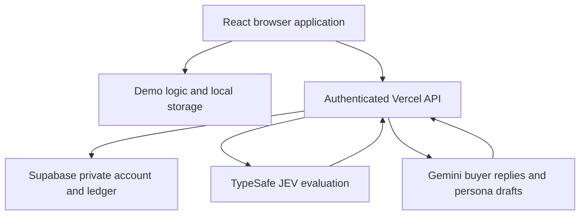
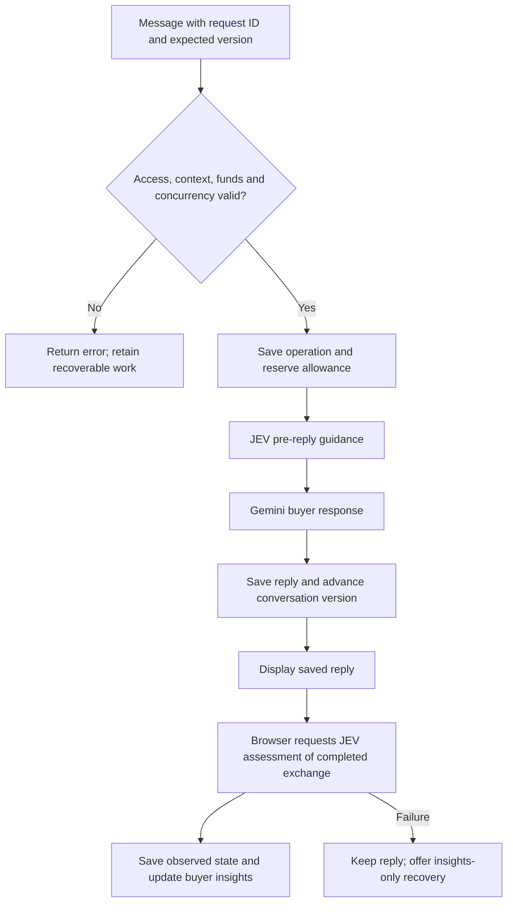

# 1906.au — Platform guide

**Audience:** product owners, operators, designers and developers.  
**Reviewed:** 23 October 2026, Australia/Melbourne.  
**Baseline:** `main` at `8298d49099965898305a72af2a7005f8ba7a877c`.  
**Companion:** [DESIGN.md](DESIGN.md) describes the interface and how to reproduce it.

This guide describes the implementation at that baseline. It separates observed production screens, source-verified behaviour and work that has not been implemented. Examples are generic. No access codes, provider credentials, private conversations or customer records are included.

## Contents

1. [Summary for non-technical readers](#1-summary-for-non-technical-readers)
2. [Scope and verification](#2-scope-and-verification)
3. [User journeys](#3-user-journeys)
4. [Architecture and responsibilities](#4-architecture-and-responsibilities)
5. [Persona creation and continuity](#5-persona-creation-and-continuity)
6. [How a live conversation works](#6-how-a-live-conversation-works)
7. [Understanding buyer insights](#7-understanding-buyer-insights)
8. [Memory and linked continuations](#8-memory-and-linked-continuations)
9. [Data, persistence and privacy boundaries](#9-data-persistence-and-privacy-boundaries)
10. [API reference](#10-api-reference)
11. [Configuration and local development](#11-configuration-and-local-development)
12. [Usage accounting and concurrency](#12-usage-accounting-and-concurrency)
13. [Operations and recovery](#13-operations-and-recovery)
14. [Validation and release procedure](#14-validation-and-release-procedure)
15. [Limits and future work](#15-limits-and-future-work)
16. [Source map and glossary](#16-source-map-and-glossary)

## 1. Summary for non-technical readers

1906.au Strategic Studio lets someone practise a conversation with a simulated buyer before approaching real customers. The user defines a buyer, describes an offer and sets one next step to explore, such as whether the buyer would agree to a demonstration. The Studio then provides a conversation and a separate view of what appears to help or hinder that next step.

The intended value is better questions, clearer propositions and earlier discovery of objections. The output is a simulation. A high readiness score is not a prediction that a real person will buy, and a convincing simulated response does not validate a market, customer need or business claim.

There are two modes:

| Mode                               | What happens                                                                                                         | Where work is saved                         | Meaning of the balance                                                                                              |
| ---------------------------------- | -------------------------------------------------------------------------------------------------------------------- | ------------------------------------------- | ------------------------------------------------------------------------------------------------------------------- |
| **Demo · illustrative only**       | A fixed example response and example insights demonstrate the experience. No AI provider is called by demo chat.     | This browser's local storage.               | Starts at 4,290 illustrative CRD; 15 are deducted per completed demo reply. These are not money or paid AI credits. |
| **Private Studio · AI simulation** | Gemini speaks as the buyer. TypeSafe JEV evaluates the conversation before the response and again after it is saved. | A private Supabase-backed shared workspace. | The remaining percentage of an administrator-set allowance, calculated from metered usage and reservations.         |

The private release has **one shared Studio User**. It has no personal registration, separate customer accounts, subscriptions or payment checkout. Anyone given the shared Studio code can access that workspace's conversations and allowance. Vercel deployment protection is an additional access layer.

Users can create, edit, duplicate, archive and restore personas. A persona can be built manually or drafted from supplied text in private mode. Generated drafts must be reviewed before saving. Unknown details should remain unknown. Choosing an emoji changes appearance only.

Every new live conversation freezes its persona and its objective, proposition and target decision. Editing a persona later affects future conversations; it does not rewrite the buyer used in an existing conversation. To test a different next step, start another conversation.

Buyer insights explain stance, readiness, the main obstacle, supporting evidence, tone and what to explore next. They distinguish tentative, unavailable and previous assessments. When a reply is already saved but its analysis fails, users can retry the analysis without generating another reply.

The most useful operating rules are:

1. Supply only material appropriate to send to the configured AI providers.
2. Review generated personas and assumptions before using them.
3. Test one concrete next decision at a time.
4. Treat insights as structured simulation feedback and verify findings with real people.
5. After an interruption, use **Refresh status** before retrying. A timeout does not prove that a request failed.
6. When working context fills, review a linked continuation. The original transcript stays saved.

## 2. Scope and verification

The GitHub repository is [mrbrave/1906-ai-studio](https://github.com/mrbrave/1906-ai-studio). The production address is [www.1906.au](https://www.1906.au/).

| Evidence checked on the review date         | Finding                                                                                                                                                           | What it establishes                                                                                                                     |
| ------------------------------------------- | ----------------------------------------------------------------------------------------------------------------------------------------------------------------- | --------------------------------------------------------------------------------------------------------------------------------------- |
| GitHub default branch and local checkout    | `main` resolves to the baseline above.                                                                                                                            | The source inspected for this guide.                                                                                                    |
| Vercel production metadata                  | Production is `READY`, connected to the same commit, with the `1906.au` and `www.1906.au` aliases. Framework: Vite; Node: 24.x; recorded function region: `iad1`. | The documented source corresponds to the deployed build. A ready deployment alone does not prove the providers or database are healthy. |
| Vercel protection metadata and browser      | Authentication protection is enabled for all deployments. Authorised temporary viewing was used for inspection.                                                   | The public URL can show a Vercel sign-in screen before the application.                                                                 |
| Production browser at 1363 × 936 CSS pixels | Demo landing, empty and completed demo chat, persona manager, persona editor, insights drawer and private access screen inspected.                                | Current desktop visuals, labels and demo behaviour.                                                                                     |
| Source and tests                            | Live orchestration, storage adapter, API contracts, configuration, ledger and responsive rules inspected.                                                         | Implemented behaviour, including private flows not opened during this review.                                                           |
| Local checks                                | `npm ci`, `npm test` and `npm run build` succeeded; 113 tests passed, none failed or skipped. Build includes TypeScript validation.                               | Reproducible baseline checks, using fixtures/mocks where the suite supplies them.                                                       |

The shared application access code was not used. No live conversation, paid synthesis, provider smoke test, production ledger inspection or database migration was performed. Environment values, account funding, provider prices/availability, backup settings, provider retention terms and deployed SQL permissions were not independently audited. Mobile behaviour is documented from the matching deployed source; no physical-device or mobile-viewport inspection was performed in this review.

## 3. User journeys

### 3.1 Explore the demo

Open the application after any deployment access gate. Select a persona on the landing page to create a local conversation, or use **Manage personas** to inspect profiles first. Send a message to see the illustrative reply, then open **Buyer insights**. Demo replies and the readiness value of 40 are fixtures; they do not vary intelligently with the offer. History and persona changes remain local to that browser.

The mode selector changes between demo and private Studio. The private view uses `#private`; most screens are React state within the same page, not separate URL routes. Do not assume there are shareable persona or conversation URLs.

### 3.2 Prepare and run a private conversation

1. Select **Private Studio · AI simulation** and enter the shared Studio access code.
2. Choose or create an active persona. Read its profile before starting.
3. Complete **What do you want to learn?**, **What are you offering?** and **What next step are you testing?**
4. Start the conversation. That persona snapshot and intent are now fixed.
5. Send a message. It appears immediately with delivery status while the buyer reply is generated.
6. Read the saved reply. Insights update separately; drafting becomes available while analysis runs, but sending remains serialised.
7. Use **Buyer insights** to review the current stance, obstacles and evidence. Follow source links in assessment details to the relevant simulated buyer statement.

Live history is restored after unlocking. Refreshing the page loses the in-memory access code, so the user must unlock again. Explicitly locking the Studio clears the code and the tab's saved private drafts and pending-request recovery data.

### 3.3 Maintain personas

**Create persona** opens the editor. **Manage personas** lists active or archived profiles, with actions to start, edit, duplicate, archive or restore. Duplication opens a new editable draft; it must be saved. Archiving hides a persona from new-conversation selection while retaining it and its history. Restore it before editing or starting a new conversation with it.

Dirty editor navigation asks whether to discard unsaved changes. Navigation is blocked during a busy editor action. These controls protect the draft; they are not an approval requirement for the platform's AI output.

## 4. Architecture and responsibilities

The application is a React single-page frontend built by Vite, with same-origin Vercel API functions. Providers are called by server code, never directly using browser-held provider keys. The database adapter uses Supabase REST RPCs rather than a browser Supabase SDK.



| Layer              | Responsibility                                                              | Main implementation                                              |
| ------------------ | --------------------------------------------------------------------------- | ---------------------------------------------------------------- |
| App shell and demo | Mode switching, demo navigation/history, fixture replies                    | `src/App.tsx`, `src/services/llmService.ts`                      |
| Private frontend   | Unlock, snapshots, optimistic messages, request recovery, analysis triggers | `src/components/LiveStudio.tsx`, `src/api/live.client.ts`        |
| Presentation       | Sidebar, chat, profiles, editor and insights                                | `src/components/`, `src/index.css`                               |
| Public contracts   | Validated persona, conversation, message and evaluation shapes              | `src/types/`, `src/api/validation.ts`, public projection modules |
| HTTP entry points  | POST-only JSON, feature gate, shared-code check, size limits and errors     | `api/`, `server/http.ts`                                         |
| Orchestrator       | Admission, reservations, provider attempts, reuse, commits and failures     | `server/turn.ts`                                                 |
| Evaluation         | Typed questions, answer parsing, evidence references, legacy/V3 routing     | `server/jev*.ts`                                                 |
| Generation         | Gemini token counting and generation; versioned persona prompts             | `server/provider.ts`, `server/persona-*.ts`                      |
| Persistence        | Bounded account JSON and optimistic compare-and-swap writes                 | `server/repository.ts`, SQL migration                            |
| Operations         | Metering, pricing assumptions and manual reconciliation                     | `server/budget.ts`, `scripts/reconcile-operation.ts`             |

The production runtime dependencies are React, React DOM and Lucide React. TypeScript, Tailwind, Vite, Testing Library, jsdom, tsx and Prettier support development. Use `package-lock.json` for exact installed versions; dependency ranges in `package.json` are not the installed-version inventory.

## 5. Persona creation and continuity

### 5.1 Profile contract

An archetype is the persisted persona record. It contains an ID, owner, name, role, emoji, budget sensitivity, behavioural instructions, timestamps, revision and an optional structured profile. Structured profiles use `profileSchemaVersion: 2`.

| Profile group       | Fields                                                                                 |
| ------------------- | -------------------------------------------------------------------------------------- |
| Context             | Industry, company size, optional age/income range, background                          |
| Goals and pressures | Goals, pain points, current tools/alternatives, constraints                            |
| Buying              | Motivations, typical objections, preferred evidence, authority, process, decision pace |
| Communication       | Style, example phrases, preferred channels, additional guidance                        |

Field provenance can be `provided`, `inferred`, `seed` or `legacy`. It records how a field entered the profile, not independent verification that it is true. Current synthesis deliberately retains only source-supported optional fields. Manual changes are user-authored information. Optional demographic fields are not instructions to stereotype behaviour.

### 5.2 Source-grounded synthesis

Private synthesis accepts up to 20,000 characters of supplied description and asks Gemini for structured JSON using `persona-synthesis-v3`. It is text extraction and drafting: it does not browse links, retrieve papers, verify customer facts or inspect external documents automatically.

Optional populated fields must be supported by excerpts from the submitted description. The parser checks normalised text containment and attribution structure, removes unsupported fields and adds review notes. It does not independently prove that a quotation semantically establishes a trait; human review remains necessary, particularly for contradictions, negation or references to other people.

Missing or unsupported required identity fields become the marked working placeholders **Synthetic buyer**, **Buyer** and **Medium** budget sensitivity. Medium is a fallback, not evidence of a genuine budget objection. The editor preserves the user's emoji when applying a generated draft. Synthesis returns a draft; it does not silently save a persona or rewrite an existing conversation.

Generation requests are version-pinned so an admitted retry cannot silently use a newer prompt/parser. Earlier supported synthesis versions remain for compatibility. A structured synthesis requests up to 6,144 output tokens; chat requests up to 2,048. An unfinished or invalid generation is rejected while known provider charges remain recorded.

### 5.3 Editing and snapshots

New personas start at revision 1. Saving an edit increments the revision and checks the revision the editor originally loaded. A conflicting edit from another tab is rejected with a recoverable conflict rather than silently overwriting newer data. Archive/restore changes availability without incrementing the behavioural revision.

Live conversations copy the persona at creation. Demo conversations use a local snapshot, with compatibility logic freezing older local records before persona edits. Existing conversations retain their earlier voice and evaluation versions. New live conversations use `persona-voice-v2` and `1906-decision-v3`; legacy conversations and their linked continuations retain the earlier paths.

Emoji validation accepts one Unicode emoji grapheme, including supported multi-codepoint sequences. It is display-only and is excluded from behavioural context. A future implementation must preserve that separation.

## 6. How a live conversation works

The pipeline is **previous decision state + new seller message + fixed intent → JEV guidance → Gemini response → durable reply → JEV completed-exchange assessment**.



The server loads the frozen persona and intent, complete stored messages and bounded working context. A new paid operation is admitted only when another operation is not running or uncertain. It stores a request hash and allowance reservation before model calls.

JEV evaluates typed questions. The parser produces a versioned decision state and telemetry. Gemini then receives the profile, fixed intent, conversation context and provisional guidance. For new voice-version conversations, Gemini receives a concise stance/topic/condition summary and verified concern excerpts, rather than the whole numeric score state. Legacy voice prompts retain their earlier state representation.

The persona prompt asks for concise first-person Australian English, natural variation, no seller coaching and no fabricated evidence, bookings or approvals. Typical objections are tendencies, not mandatory resistance. Buyer statements can resolve a concern; seller reassurance alone cannot. Prompt conditioning is not a mathematical guarantee of generated behaviour.

Only committing a completed reply advances the conversation version. The browser displays that response before assessment is finished. Replies are returned as complete responses, not streamed token by token.

The second JEV call evaluates the completed exchange. It updates `observedState` and the reply's evaluation without producing a new Gemini response. A stale reply ID or conversation version cannot overwrite newer insights. The latest applicable observed state informs the next turn.

Assessment is browser-triggered. There is no background worker or scheduled job to finish it after the tab closes. After unlocking again, **Update insights** can request assessment of the latest saved reply.

## 7. Understanding buyer insights

| Concept                 | Meaning                                                                             | Interpretation boundary                                                                                            |
| ----------------------- | ----------------------------------------------------------------------------------- | ------------------------------------------------------------------------------------------------------------------ |
| Stance                  | Exploring, conditional agreement, agreement, decline or unknown for the target step | Requires supporting simulated buyer evidence. Politeness is not commitment.                                        |
| Decision readiness      | A JEV score on a 0–4 rubric, multiplied by 25 and rounded to one decimal            | A 0–100 simulation index, not a conversion probability.                                                            |
| Supporting evidence     | A separate 0–4 judgement about support for this specific next decision              | Seller claims stay claims. Repetition and simulated acceptance do not establish real-world truth.                  |
| Assessment grounding    | A 0–1 judgement of whether enough conversation exists to assess readiness           | Different from evidence supporting the offer. A well-supported refusal can have high grounding.                    |
| Sentiment               | Tone towards the proposition                                                        | Positive sentiment can coexist with refusal or conditions.                                                         |
| Friction                | The dominant supported obstacle to the next step                                    | Cost, commercial terms, credibility, implementation, fit, timing, authority, identity fit, other, none or unknown. |
| Confidence              | Model-supplied estimate for a dimension                                             | Not calibrated accuracy or a guarantee.                                                                            |
| Conditions and concerns | Outstanding requirements and tracked active/resolved/reopened concerns              | Requires attributed evidence; unresolved conditions prevent an unconditional agreement label.                      |

Readiness rubric anchors are: unwilling; only willing to clarify; willing to explore with material concerns; willing subject to minor conditions; sufficient evidence of readiness for the specified step. A demonstration and a purchase require different commitments and evidence.

V3 parsing retains separate dimension statuses: complete, provisional, missing, invalid or unavailable. Low confidence or insufficient grounding is not silently turned into confident data. Missing/invalid readiness or zero grounding makes readiness unavailable; grounding below 0.75 contributes to a provisional overall assessment. Legacy `evidenceSufficiency` is labelled earlier assessment grounding, not retroactively interpreted as V3 supporting evidence.

Evidence references point to stored assistant messages, which represent the simulated buyer. Quotes are checked against those messages, including retained exact memory excerpts. The UI rechecks public quotes before displaying or using them. This establishes transcript consistency, not external factual accuracy.

**What to explore next** uses deterministic frontend rules based on public state and verified buyer quotations. It is not another AI call. A decline leads to acknowledging the decision; an evidenced agreement leads to confirming the next step; other states suggest a focused question about the remaining obstacle.

Optional authored motivational profiles and their evaluation are server-only. They are hypothetical inputs, not discovered facts about real individuals. Their weights, labels and assessments are excluded from public projections and the Gemini response context. This guide does not reproduce any private profile values.

## 8. Memory and linked continuations

The full stored transcript and the model's working context are different things. The transcript stays in the account JSON. Model requests use a bounded context to control size, preserve attribution and avoid repeated generative summarisation.

Once remaining message content exceeds 12,000 serialised bytes and there are more than four messages, older messages are compacted into exact attributed paragraphs. Every older buyer paragraph is retained. Seller retention includes the first and last paragraph and paragraphs matching conditions, questions, numbers, proposals, evidence or other decisive markers. The latest four messages remain verbatim.

Memory records retain message IDs, speaker, exact quotation, version and omitted-seller-paragraph count. Stored quotations are checked against the transcript. The UI exposes retained memory and omissions. Selection is heuristic: some seller detail can be omitted, and keyword retention does not guarantee perfect semantic coverage.

Older memory is limited to 12,000 bytes. The full JEV request, including questions and context, is limited to 48,000 bytes. A context-limit error preserves transcript and draft. It offers **Review linked continuation**, with an editable summary up to 8,000 characters.

The continuation copies the persona, intent and versioned prompt/rubric choices, links back to the original conversation and starts with version 0 and no decision state. The reviewed summary supplies context, labelled as user-reviewed and not independently verified. It does not silently carry forward an old score as a current assessment. The original conversation remains accessible. An unfinished running or uncertain dialogue must be recovered before continuing.

## 9. Data, persistence and privacy boundaries

### 9.1 Actual deployed storage design

The SQL migration creates **one `studio_private.account` row** with `revision`, JSON `state` and `updated_at`. The table has row-level security enabled, and schema/table access is revoked from public, anonymous and authenticated browser roles. Two security-definer RPCs, `public.studio_read()` and `public.studio_write(expected_revision, next_state)`, are granted to `service_role` only.

The TypeScript `Database` interface also describes future normalised `users`, `archetypes`, `conversations` and `messages` tables. **Those are adapter contracts, not the SQL layout created by the migration.** Do not create a second schema merely because those interfaces exist.

| JSON area                  | Contents                                                                                    | Exposure                                                                                |
| -------------------------- | ------------------------------------------------------------------------------------------- | --------------------------------------------------------------------------------------- |
| `data`                     | Logical user, persona, conversation-list and message records                                | Explicit public projection after application authentication                             |
| `conversations`            | Frozen persona/intent, version, decision states, memory and continuation links              | Public subset; private revision inputs excluded                                         |
| `operations`               | Request/hash, status, reservation, provider attempts, usage, raw results and saved outcomes | Browser receives operation ID, conversation ID, status and error; not receipts or money |
| `adjustments`              | Manual cost reconciliation with reasons and timestamps                                      | Server/operator only                                                                    |
| `personaPrivateByRevision` | Optional private revision-specific persona inputs                                           | Server/operator only                                                                    |
| `personaMutations`         | Idempotency receipts for free persona mutations                                             | Server only                                                                             |

Writes use optimistic compare-and-swap: only the reader of the current account revision can commit the next state. Pure mutations retry conflicts up to eight times; provider calls are kept outside those retries to avoid repeat charges from a database write conflict.

### 9.2 Browser and provider data

| Location or recipient   | Data involved                                                                                                                                               |
| ----------------------- | ----------------------------------------------------------------------------------------------------------------------------------------------------------- |
| Demo local storage      | Key `1906_studio_v1`; local personas, history, messages and illustrative credits. A known legacy persona key can be imported locally.                       |
| Private session storage | Key `1906-private-drafts-v1`; draft text and pending request ID, message, conversation and version. Reload recovery is scoped to the browser tab.           |
| Browser memory          | Shared Studio code and current working snapshots. The code is not saved in local/session storage.                                                           |
| TypeSafe JEV            | Persona context, fixed intent, attributed history/memory, previous state and evaluation questions; optional configured private profile for evaluation only. |
| Gemini                  | Supplied description for synthesis, or public buyer profile/instructions, intent, bounded transcript/memory and provisional guidance for dialogue.          |
| Supabase                | Durable account JSON, complete transcript and private operation/usage records.                                                                              |
| Google Fonts            | External stylesheet/font requests for Epilogue and Manrope from the frontend.                                                                               |

All private Studio code holders share the same workspace boundary. There is no individual identity, tenant isolation or per-person audit identity. The account lock serialises operations; it is not rate limiting or an authentication system.

Public output uses explicit allowlists, including nested projections. Dollar allocations, provider receipts, rate data and private motivation fields must remain server-only. User-facing custom role-play instructions are editable public persona context, not secret credentials. Do not put secrets in any persona or conversation field.

No automatic retention expiry, user-facing transcript export, conversation deletion, customer data-request workflow or backup/restore UI is implemented. Persona archiving is not deletion. Operators must verify backup and retention arrangements outside the app. No legal compliance, data residency or provider non-retention certification is asserted here.

## 10. API reference

These are internal same-origin JSON endpoints. Except for a method rejection, requests pass the live feature gate and shared access-code check before the action. Supply `Content-Type: application/json` and `Authorization: Bearer <STUDIO_ACCESS_CODE>`. The placeholder is not a real credential. Responses set `Cache-Control: no-store`.

| Endpoint               | Request body                                                       | Successful result                                                                  |
| ---------------------- | ------------------------------------------------------------------ | ---------------------------------------------------------------------------------- |
| `POST /api/studio`     | A supported `action` and its fields, listed below                  | `LiveSnapshot`                                                                     |
| `POST /api/dialogue`   | `conversationId`, `pitch`, `expectedVersion`, `requestId`          | `{ result: TurnResult, usage: UsageSummary }`                                      |
| `POST /api/assessment` | `conversationId`, latest `replyId`, `expectedVersion`, `requestId` | Same wrapper; existing reply text with completed assessment                        |
| `POST /api/archetype`  | `description`, `requestId`                                         | `{ result: ArchetypeDraft, usage: UsageSummary }`; review and save separately      |
| `POST /api/evaluate`   | Retired endpoint                                                   | `410` after the shared access gates; evaluation now belongs to dialogue/assessment |

`/api/studio` actions:

| Action                  | Fields beyond `action`                                         | Behaviour                                                                        |
| ----------------------- | -------------------------------------------------------------- | -------------------------------------------------------------------------------- |
| `snapshot`              | None                                                           | Loads projected state and usage; no model request                                |
| `save_archetype`        | New UUID `id`, validated `draft`                               | Saves a persona; reusing an ID with different content conflicts                  |
| `update_archetype`      | `id`, `expectedRevision`, `draft`, UUID `requestId`            | Revision-checked persona edit with idempotency receipt                           |
| `archive_archetype`     | `id`, `expectedRevision`, boolean `archived`, UUID `requestId` | Archive or restore without deleting history                                      |
| `create_conversation`   | UUID `id`, `archetypeId`, `intent`                             | Freezes active persona and intent                                                |
| `continue_conversation` | UUID `id`, UUID `sourceId`, reviewed `summary`                 | Creates linked conversation preserving persona/intent and compatibility versions |

`intent` contains `objective`, `proposition` and `targetDecision`. `LiveSnapshot` contains projected `data`, `conversations`, `usage` and operation summaries. `TurnResult` contains `text`, `telemetry`, `state`, `version` and normally `replyId`. `UsageSummary` contains `remainingPercentage`, `status` and `updatedAt`.

The frontend reuses `replyId` as an assessment request ID. Paid operation IDs identify an immutable request payload and kind. Reuse the original ID and payload during recovery; changing content under the same ID returns a conflict. Expected conversation versions and persona revisions protect different objects and are not interchangeable.

| Status | Typical meaning                                                               | Response                                                                          |
| ------ | ----------------------------------------------------------------------------- | --------------------------------------------------------------------------------- |
| `400`  | Invalid JSON, contract or unsupported action                                  | Correct the input; generic contract failures deliberately avoid leaking internals |
| `401`  | Missing or incorrect application code                                         | Unlock again                                                                      |
| `402`  | Insufficient allowance for the reservation                                    | Operator reviews/increases the total allowance                                    |
| `404`  | Missing persona, conversation or source                                       | Refresh and verify the reference                                                  |
| `405`  | Method other than POST                                                        | Use the documented method                                                         |
| `409`  | Version/request conflict, busy/uncertain operation or test quota              | Refresh; preserve request identity; recover outstanding work                      |
| `410`  | Retired evaluation route                                                      | Use dialogue or assessment flow                                                   |
| `413`  | Request, working context or token-count limit                                 | Shorten unadmitted input or use reviewed continuation as appropriate              |
| `502`  | Provider/counting/output failure                                              | Inspect known versus uncertain outcome before retrying                            |
| `503`  | Disabled/unconfigured live service, storage or model/rate configuration issue | Operator checks server configuration and storage                                  |

## 11. Configuration and local development

### 11.1 Environment contract

All variables below are server-only. Production values were not retrieved for this guide. `.env.example` is the committed setup reference. Never prefix provider credentials, service credentials or the private allowance with `VITE_`, because Vite exposes prefixed values to browser code.

| Variable                    | Required value or placeholder                 | Purpose                                                  |
| --------------------------- | --------------------------------------------- | -------------------------------------------------------- |
| `STUDIO_ENABLE_LIVE`        | `false` by default; `true` for enabled Studio | Server feature gate                                      |
| `STUDIO_ACCESS_TOKEN`       | `<RANDOM_SECRET_AT_LEAST_32_CHARACTERS>`      | Shared application access code                           |
| `STUDIO_BUDGET_USD`         | `<ADMINISTRATOR_CHOSEN_TOTAL_USD>`            | Lifetime allocation; no automatic default                |
| `SUPABASE_URL`              | `https://<PROJECT>.supabase.co`               | Storage project origin; HTTPS required                   |
| `SUPABASE_SERVICE_ROLE_KEY` | `<SERVER_ONLY_SERVICE_ROLE_KEY>`              | Execute private read/write RPCs                          |
| `TYPESAFE_API_KEY`          | `<SERVER_ONLY_TYPESAFE_KEY>`                  | JEV API access                                           |
| `JEV_MODEL`                 | `jev-1.13.0`                                  | Model accepted by this integration's rate/contract guard |
| `GEMINI_API_KEY`            | `<SERVER_ONLY_GEMINI_KEY>`                    | Gemini Developer API access                              |
| `GEMINI_MODEL`              | `gemini-3.8-flash`                            | Model accepted by the current rate guard                 |
| `GEMINI_BILLING_TIER`       | `paid` or `free`                              | Choose the implemented Gemini cost estimate              |

These model names describe the repository's supported configuration. This review did not check current provider availability or prices. Changing a model name in Vercel alone is insufficient: unknown model/rate combinations fail closed. Upgrade contracts, rate cards, fixtures and compatibility handling together before changing production configuration. Image generation and the newer TypeSafe image header are not integrated in this baseline.

### 11.2 Setup

1. Use Node 24 and a clean checkout of the required branch. Run `npm ci`.
2. For private testing, choose isolated Supabase storage and run `migrations/001_private_studio.sql` through an authorised administrator. Review existing data and backups before database work.
3. Configure server environment variables securely for the intended Vercel environment. Use distinct Preview and Production storage/allowances to avoid shared test charges and history.
4. Run `npm test` and `npm run build`. `npm run lint` is TypeScript checking (`tsc --noEmit`), not ESLint.
5. `npm run dev` serves the local demo at `http://localhost:3000`. Use an authenticated `vercel dev` environment for the server API; Vite alone does not run Vercel functions. `npm run preview` previews the built frontend.
6. Deploy through a reviewed PR and the connected Vercel project. Confirm the deployed commit and protection settings, then run a separately authorised provider/storage smoke test against isolated data.

Vercel specifies 120-second maximum durations for dialogue, archetype and assessment functions. The client waits 125 seconds. Storage RPC and Gemini token-count requests use 10-second timeouts; model HTTP requests use 30 seconds. There are no automatic model-call retries. The configured hosting plan must support the function settings.

Keep `.js` extensions on relative runtime server imports where the compiled ESM runtime requires them. Native-Node compiled-route tests guard against the earlier missing-module regression. Type-only imports do not create runtime dependencies.

## 12. Usage accounting and concurrency

The allocation is an internal USD spending allowance, not a provider wallet balance. The browser displays only its remaining percentage:

```text
remainingPercentage = max(0, allocation - meteredCost - activeReservations)
                      / allocation * 100
```

The implementation stores money as integer nanodollars: one USD equals 1,000,000,000 units. The calculation includes recorded attempts and manual adjustments, so changing browser storage cannot reset live usage. Reservations temporarily reduce the percentage; releasing unused reservation can increase it.

| Operation                                                          | Model work ordinarily metered                                |
| ------------------------------------------------------------------ | ------------------------------------------------------------ |
| Dialogue                                                           | JEV pre-reply evaluation and Gemini response                 |
| Completed-reply assessment                                         | A separate JEV evaluation                                    |
| Persona synthesis                                                  | Gemini generation                                            |
| Snapshot, manual save/edit, archive/restore, conversation creation | No model call; hosting/storage costs are outside this ledger |

Each provider attempt stores its model, rate version, token usage, cost and raw receipt before output interpretation. Known usage stays charged even when parsing fails or a later stage fails. Gemini cost calculation distinguishes uncached input, cached input and generated/thinking tokens. The implemented JEV output rate is zero. Free Gemini mode estimates zero Gemini cost but does not remove provider quota limits or JEV charges.

`server/budget.ts` is the authoritative implemented rate card. It currently contains a date-dependent paid Gemini rate factor beginning 1 January 2027. This is a code rule, not confirmation of a current provider quotation. Check official billing and reconcile before relying on it financially. Taxes, discounts, promotional credit and platform costs are outside the estimate.

Admission reserves a conservative envelope rather than guessing cost from character count. Gemini input is counted through the provider API before generation and capped at 32,768 tokens; the reservation's output envelope is 131,072 tokens including reasoning. The reservation can reject a request despite a small positive remaining percentage. It is not an absolute provider invoice cap.

One account-wide logical paid-operation lock, enforced through durable revision-checked writes, prevents overlapping paid operations across tabs/functions. A running or uncertain operation blocks new paid work throughout the shared account. Completed request IDs return stored results. Retry paths reuse saved valid JEV decisions and usable Gemini output where possible, while rejected output can require a new attempt. Exactly-once provider execution cannot be guaranteed after an ambiguous network outcome.

To replenish usage, an operator increases `STUDIO_BUDGET_USD` to the new **total lifetime allocation** and redeploys. Recorded spending is not reset. Deployments sharing storage must use the same allocation. This guide specifies no actual budget amount and makes no payment commitment.

## 13. Operations and recovery

### 13.1 User recovery

| Situation                       | What to do                                          | Preserved behaviour                                                              |
| ------------------------------- | --------------------------------------------------- | -------------------------------------------------------------------------------- |
| Slow or interrupted reply       | Use **Refresh status** before retrying              | A completed server result is loaded without generating it again                  |
| Known failed dialogue           | Use **Retry reply** with the original request       | The unfinished turn must be resolved before another message in that conversation |
| Reply saved, insights failed    | Open **Buyer insights**, then **Retry insights**    | Existing reply remains; only metered JEV analysis is requested                   |
| Closed before analysis          | Unlock, refresh and choose **Update insights**      | Assessment applies only to the latest eligible saved reply                       |
| Lost response or uncertain cost | Refresh; ask operator to review if still uncertain  | Exact request identity and reservations remain; no silent resubmission           |
| Page reload                     | Unlock again and recover tab-scoped draft/request   | Code was not persisted; saved server history remains                             |
| Unsaved persona conflict        | Return to personas and reopen the current revision  | Conflicting data is not silently overwritten                                     |
| Context full                    | Review and create a linked continuation             | Original transcript, persona and target remain                                   |
| Browser draft/storage warning   | Copy the draft or preserve the tab before reloading | In-memory fallback is not a durable-storage guarantee                            |

Definitively rejected, unadmitted requests may be edited. Ambiguous admitted requests keep their ID and original payload until status is established. **Recover last request** restores text; it does not send it automatically.

### 13.2 Administrator recovery

Inspect `studio_private.account` through authorised database administration. Review operation/attempt status, timestamps, raw receipts, known charges and reservations. Do not expose the account JSON to end users or paste it into public issues.

For an uncertain or interrupted running operation, independently check the provider's reporting for additional unrecorded cost. The operator-only `scripts/reconcile-operation.ts` accepts JSON on standard input containing `operationId`, `unknownCostUsd` and a meaningful `reason`. It requires the same securely loaded server environment. For a running operation it waits at least three minutes before allowing reconciliation.

The amount is the independently verified **additional unrecorded** USD charge; it must exclude charges already recorded. Do not assume zero because the browser timed out. The script retains known charges, records a reconciliation adjustment/reason, releases the reservation and marks the request failed/retryable. Refresh the Studio and retry its saved request. There is no automatic reconciliation service or administrator UI.

### 13.3 Diagnostic sequence

1. Check whether the failure is Vercel deployment authentication, application unlock, API configuration, database access or provider work. These are different layers.
2. Verify the deployed commit and build/runtime logs. A successful frontend build does not verify live server configuration.
3. If an API reports missing/disabled configuration, inspect the correct deployment environment and redeploy after changes.
4. If a request is admitted, inspect its operation before any retry or model switch. Missing usage or unreadable provider responses can require reconciliation.
5. Check working-context and archive limits rather than deleting records to make the error disappear. Back up before any reset or migration.

## 14. Validation and release procedure

For this documentation review the unchanged application baseline passed **113 automated tests** and `npm run build`, which runs TypeScript and Vite. Tests include API/access checks, provider-order fixtures, money arithmetic, request identity/recovery, concurrency, memory attribution, persona compatibility/management, emoji handling, source-grounded synthesis, voice/evaluation contracts, private projections and browser-component workflows. Native-Node compiled-route checks exercise server import resolution.

These tests do not establish real customer validity, production backup quality, live billing accuracy or provider behaviour with real accounts. The suite's mocked provider and repository tests must not be described as live Gemini, JEV or Supabase verification.

For future implementation releases:

1. Branch from the intended current base; inspect existing documentation and compatibility versions.
2. Update behaviour, meaningful tests and the affected documentation together. Preserve existing persona/conversation snapshots and ledger records.
3. Run the required TypeScript checks, automated suite and production build. Inspect rendered UI at desktop and mobile sizes for interface changes.
4. Use isolated Preview storage and an explicit allowance for any billable smoke test. Verify reply, post-reply assessment, history reload and ledger outcome.
5. Open one concrete PR with scope, results, limitations and preview information. **Leave merge and production promotion to the owner's review. Do not enable auto-merge.**

This document and `DESIGN.md` are documentation-only changes; they require no SQL migration, environment change or model request. No application behaviour or access settings are changed by the documents.

## 15. Limits and future work

### 15.1 Enforced limits

| Area                               | Baseline limit                                                                        | Source                  |
| ---------------------------------- | ------------------------------------------------------------------------------------- | ----------------------- |
| Shared account                     | One Studio User; one admitted paid operation at a time                                | Repository/orchestrator |
| Conversations                      | 100                                                                                   | `server/studio.ts`      |
| Paid operation records             | 2,000                                                                                 | `server/turn.ts`        |
| Serialised account archive         | Application guard: 8,000,000 bytes; SQL has a separate 9,000,000-byte JSON-text guard | Repository/migration    |
| HTTP JSON body                     | 128,000 bytes                                                                         | `server/http.ts`        |
| Live message                       | 4,000 characters                                                                      | Chat/turn validation    |
| Demo message                       | 16,000 characters                                                                     | Chat component          |
| Synthesis description              | 20,000 characters                                                                     | Task limits             |
| Persona name / role / instructions | 120 / 200 / 16,000 characters                                                         | Draft validation        |
| Structured profile                 | 12,000 UTF-8 bytes; individual fields also bounded                                    | Persona profile parser  |
| Profile lists                      | 12 items per list, 500 characters per item                                            | Persona profile parser  |
| Objective / proposition / target   | 1,000 / 2,000 / 1,000 characters                                                      | Intent validation       |
| Continuation summary               | 8,000 characters                                                                      | Studio validation       |
| Working memory / JEV request       | 12,000 / 48,000 serialised bytes                                                      | Context module          |
| Gemini input                       | 32,768 counted tokens                                                                 | Provider/budget         |
| Requested output                   | Chat: 2,048 tokens; structured synthesis: 6,144 tokens                                | Budget/synthesis        |
| Private allocation parser          | Maximum USD 10,000; zero is accepted but provides no usage                            | Budget module           |

Characters, UTF-8 bytes and model tokens are different measurements. A field within its character limit can still contribute to an aggregate byte/token limit. Reaching archive/ledger limits stops new work; the application does not silently prune history or financial records.

### 15.2 Not implemented in this baseline

| Capability                     | Present state                                                                                                   |
| ------------------------------ | --------------------------------------------------------------------------------------------------------------- |
| Public multi-user SaaS         | Shared private workspace only; individual auth, roles and tenant isolation are absent                           |
| Customer billing/subscriptions | No checkout, subscription or customer grant UI                                                                  |
| OpenAI live engine             | Historical provider types remain, but the supported live UI/pipeline uses Gemini and JEV                        |
| Retrieval/research             | No automatic web research, RAG/vector store, source ingestion or browsing from pasted links                     |
| Multimodal generation          | No image, video, voice, file-upload or TypeSafe image workflow                                                  |
| Background execution           | No worker, queue, cron or guaranteed assessment after tab closure                                               |
| Chat streaming                 | Complete saved reply returned, not a token stream                                                               |
| External actions               | Simulated agreement does not book, email, purchase or update a CRM                                              |
| Data lifecycle tooling         | No transcript export/deletion UI, automatic expiry or in-app archive/reset procedure                            |
| Collaboration                  | No per-person workspace permissions or simultaneous paid operations                                             |
| Validated forecasting          | No calibrated readiness prediction or external empirical validation of conversion                               |
| Security expansion             | No application rate limiter or individual sessions; deployment protection and shared code are the current gates |

These are boundaries for planning, not approved implementation work. Before expanding access or scale, design individual identity, isolation, rate limits, retention/export, a scalable store, monitoring and reconciliation around the actual requirements. A new database adapter must preserve snapshot semantics, request identity, cost history and compatibility versions.

## 16. Source map and glossary

### 16.1 Authoritative sources

For this review, source links can be pinned to [baseline commit 8298d49](https://github.com/mrbrave/1906-ai-studio/tree/8298d49099965898305a72af2a7005f8ba7a877c). Relative links below follow the branch on which this document is read. When code changes, update this guide's baseline and recheck the affected claims.

| Question                          | Read                                                                                                                                                                                                                                                                                                                                                                                |
| --------------------------------- | ----------------------------------------------------------------------------------------------------------------------------------------------------------------------------------------------------------------------------------------------------------------------------------------------------------------------------------------------------------------------------------- |
| Where do I start?                 | [README.md](README.md), [.env.example](.env.example), [package.json](package.json)                                                                                                                                                                                                                                                                                                  |
| What does it look like?           | [DESIGN.md](DESIGN.md), [styles](src/index.css), [Tailwind configuration](tailwind.config.js)                                                                                                                                                                                                                                                                                       |
| What is stored?                   | [Logical records](src/types/database.types.ts), [live contracts](src/types/live.ts), [repository](server/repository.ts), [SQL](migrations/001_private_studio.sql)                                                                                                                                                                                                                   |
| What is sent publicly?            | [Public projections](src/api/publicData.ts), [evaluation projection](src/api/publicEvaluation.ts)                                                                                                                                                                                                                                                                                   |
| How do requests run?              | [HTTP gate](server/http.ts), [Studio actions](server/studio.ts), [orchestrator](server/turn.ts), [provider](server/provider.ts)                                                                                                                                                                                                                                                     |
| How are personas created?         | [Editor](src/components/ArchetypeSynthesizer.tsx), [grounding](server/persona-grounding.ts), [profile parser](src/api/personaProfile.ts), [management](src/services/personaManagement.ts)                                                                                                                                                                                           |
| How are buyers evaluated?         | [Evaluation router](server/jev.ts), [V3](server/jev-v3.ts), [V2](server/jev-v2.ts), [evidence](server/jev-evidence.ts), [insights rules](src/services/buyerInsights.ts)                                                                                                                                                                                                             |
| How do memory and voice work?     | [Context](server/context.ts), [voice prompts](server/persona-prompts.ts)                                                                                                                                                                                                                                                                                                            |
| How are costs recovered?          | [Budget](server/budget.ts), [reconciliation](scripts/reconcile-operation.ts), [private frontend](src/components/LiveStudio.tsx)                                                                                                                                                                                                                                                     |
| What historical rationale exists? | [Continuity review](docs/studio-continuity-review.md), [contracts](docs/persona-contracts-step-1.md), [management](docs/persona-management-step-2.md), [synthesis/voice](docs/persona-synthesis-voice-step-3.md), [evaluation](docs/jev-evaluation-step-4.md), [chat/insights](docs/chat-insights-step-5.md), [combined improvements](docs/persona-chat-improvements-validation.md) |

Historical notes may describe earlier test totals or intermediate contracts. Current implementation and newly recorded verification take precedence over assumptions copied from those notes. External provider links in the README are background references, not fresh provider verification performed for this guide.

### 16.2 Glossary

| Term                       | Plain meaning                                                                                                     |
| -------------------------- | ----------------------------------------------------------------------------------------------------------------- |
| Archetype / persona        | The configured simulated buyer; archetype is the storage/API name                                                 |
| Intent                     | The fixed objective, offer and target next decision for one conversation                                          |
| JEV                        | The TypeSafe model used for structured evaluation                                                                 |
| Gemini                     | The configured generation model used for buyer replies and persona drafts                                         |
| Telemetry / buyer insights | The machine-readable assessment and its human-readable interface                                                  |
| Snapshot                   | A frozen persona or a current projected copy of saved workspace data, depending on context                        |
| Revision / version         | A number used to detect conflicting changes to a persona, conversation or account                                 |
| Idempotency                | Reusing the same request ID retrieves/reuses the same operation instead of treating it as new work                |
| Reservation                | Allowance temporarily held before paid provider work                                                              |
| Reconciliation             | An operator checks uncertain provider cost and records the resolution                                             |
| RPC                        | A named database function called by the server                                                                    |
| Extractive memory          | Exact selected transcript paragraphs, with attribution, rather than a newly invented summary                      |
| Grounding                  | Either consistency with supplied source text or enough conversation to assess a dimension; the guide states which |
